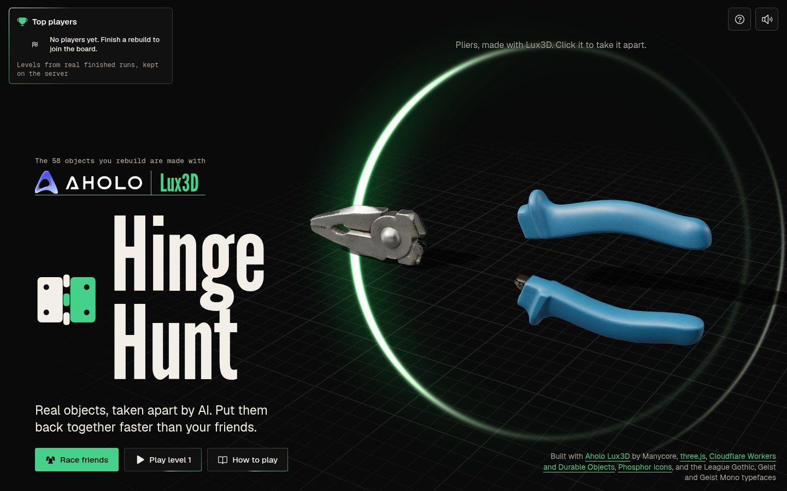
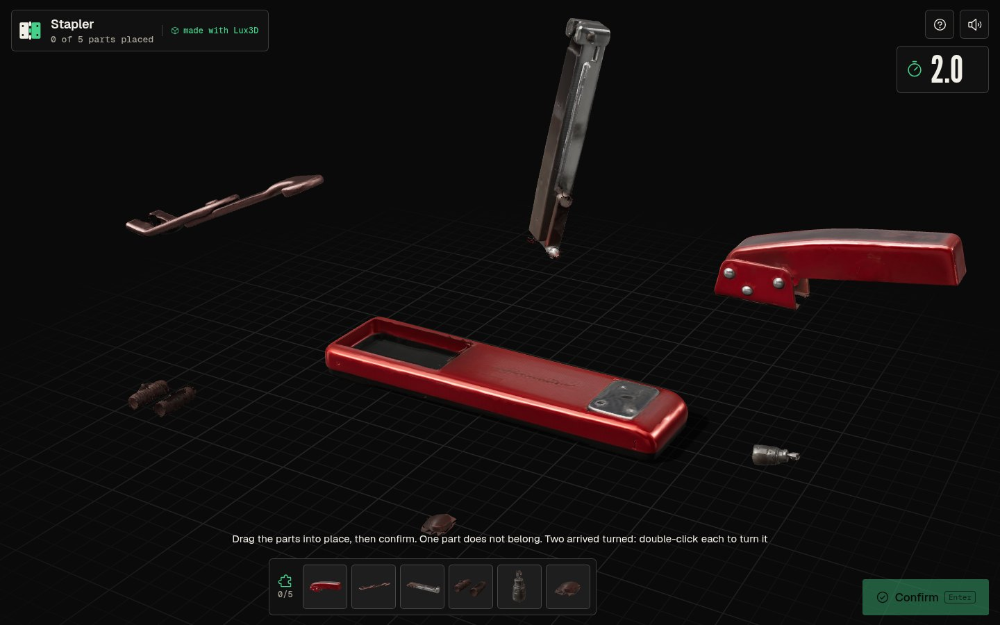
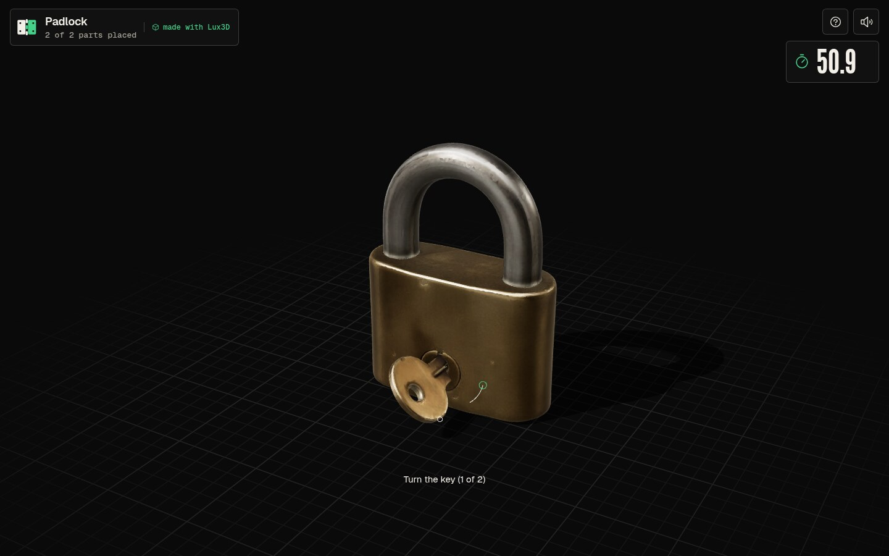
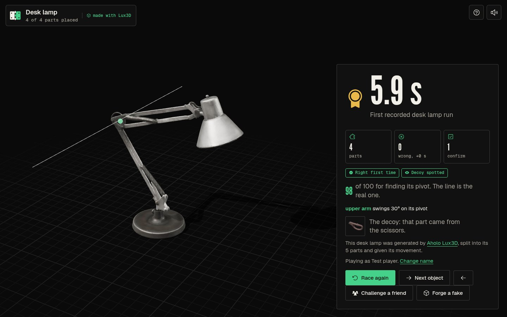
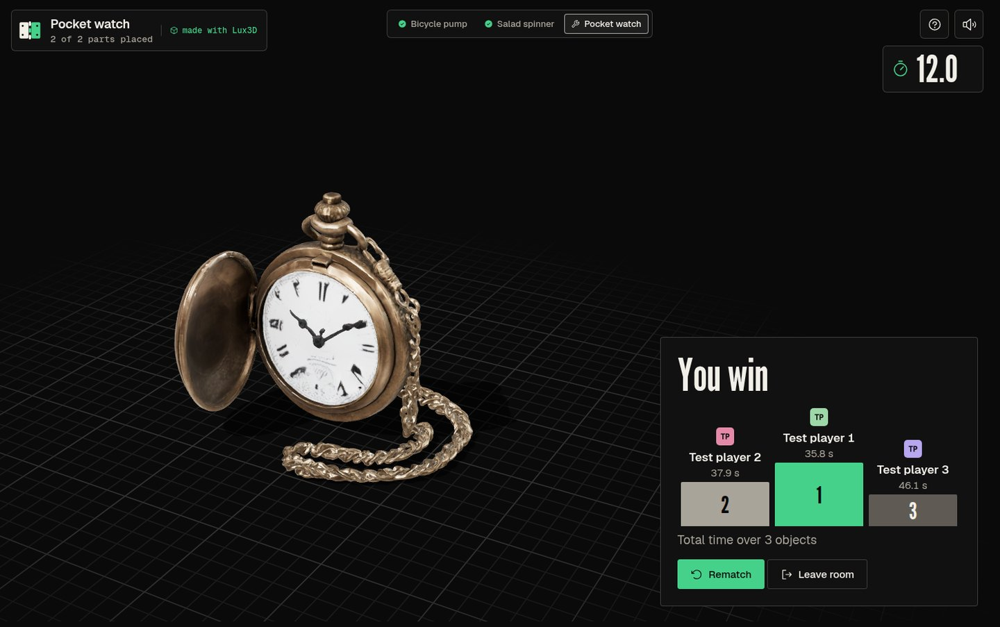
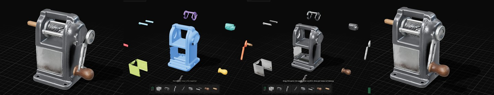

# Hinge Hunt

Real objects, taken apart by AI. Put them back together faster than your friends.

**Play:** https://hingehunt.timidan.xyz



Built for the Manycore Aholo Global 3D AI Hackathon. Every object you rebuild was made with [Aholo Lux3D](https://www.aholo.ai/): generated from text, split into its real parts, and given its movement. The exceptions: one knob on the radio turns on a joint we set by hand, and a few ranges of movement we narrowed (see below). The landing shows these objects one after another; tap one and it comes apart.

## How a round works



1. An object turns into view and works once, with its own sound: a stapler's arm snaps, a padlock's key turns and its shackle lifts, a crank ratchets. About 3.5 seconds after the object appears, its parts are in the tray and the clock starts.
2. It comes apart, and its parts land in a tray around the base.
3. Drag each part back where it belongs. Nothing snaps into place; when you think it's right, press Confirm. Right parts lock in. Wrong ones fly back to the tray at +3 s each. A part you leave in the tray, or drop back on its place there, costs nothing. Every 15 seconds the finished object flashes up for a second, so you can check where the parts go, and Hint shows it once an object for 1.5 seconds.
4. One part in the tray is a decoy: a part of similar shape and size taken from a different object. From Level 2 it takes on the colour of the part it imitates, so you have to spot it by its shape. Leave it out. The result says where it came from. (If its object hasn't loaded when the parts come apart, the round goes ahead without one.)
5. A long part arrives a quarter turn round (two from Level 4, on objects with two long parts; objects with no long part have none). Double-tap it, or press R with the pointer on it, and it turns straight back. Confirm tells you when a part is in place but turned.


6. On 11 objects, rebuilding isn't the end: the clock runs until you make it work with your own hand, along its real joint. Turn the padlock's key and lift the shackle, crank the pencil sharpener a full turn, push the pump down.
7. When the build is right, the object works again and the game says what moved ("snap bar swings 180° on its pivot"). On the others that swing or turn, a bonus: tap where it pivots, and the real axis is drawn through it with a score out of 100. (Seven objects only slide, like the vise and the drawer unit; they have no pivot to find.)



*The times in these screenshots come from scripted test runs on a busy test machine, not from people.*

**Race friends.** Press Race friends and share the link. Everyone in the room gets the same three objects, starts each one at the same moment (a slow connection starts as soon as its parts arrive), and sees the others' progress live. The first to finish starts a 30-second countdown for everyone else. Lowest total time wins; there's a podium and a rematch.

**Play alone, level by level.** The 58 objects are in six levels by effort: the parts to put back, plus one for each part you work by hand and each moving joint after the first. Level 1 is two-part objects like scissors; Level 6 holds the biggest, up to 13 parts, like the treasure chest. A new player starts with a warm-up on the bicycle pump: two parts and a handle to push. Rebuild 3 objects of a level to clear it and open the next; a level opens with an object you work by hand, if it has one. In each round you race a real recorded run of an earlier player, shown as recorded. The 20 fastest finished races per object are kept. If an object has no runs yet, there is no rival; none are made up. **Challenge a friend** on the result sends a link to the same object with the same decoy, racing your run if it made that object's 20 fastest.

**Forge a fake.** After a round alone you can forge a fake part for a friend. Pick the real part it stands in for and describe your fake in a few words. Lux3D makes it from your words and the object's name while you wait (G1-Turbo text-to-3D at 10,000 faces, about 2 minutes), and your challenge link hides it in your friend's tray in place of the usual decoy, sized like the part you picked. Their result names you and quotes your words, and says whether it fooled them. Once the forge has closed, the landing and every result offer a fake the game's maker forged before then (a pliers handle and a pair of scissors), so the idea can still be played.

**Join with a name.** A new browser picks a name before its first game. There is no account: the browser keeps the name and a random id, and every run carries both. The landing's board ranks players by levels cleared, then progress in the next level, then the total of their 3 fastest rebuilds in each cleared level. Tap a player to see the object times behind it. Where the screen has no room for the board, a Top players button opens it.



## How Lux3D makes every object



| Step | Lux3D call | What the game gets |
|---|---|---|
| Model | text-to-3D (G1-Turbo) | a textured GLB of the object |
| Parts | part-split | the object's real components (lever, pin, jaw, spring) as separate meshes, in the model's own frame |
| Movement | articulation | a URDF: which parts move, about which axis, and how far |
| Rig | ours: `spike/rig.py` | each split part matched to the moving part it rides; a part that spans a joint is cut so each piece moves with its side |

Both Lux3D outputs come from the same mesh, so the parts line up with the movement: the rebuilt object really works. On 54 objects the match is exact; `rig.py` records each part's fit, and on the treasure chest, the toolbox, the drawer unit and the lunch box the articulated mesh differed a little, so their parts were matched to the nearest moving part (a median gap of up to a tenth of the object's size).

The game has 58 objects, chosen for real moving parts: nail clipper, stapler, Venus flytrap, mousetrap, desk lamp, hole punch, padlock, music box, toolbox, pencil sharpener, treasure chest, bench vise, corkscrew, scissors, pliers, garden pruners, telescope, spray bottle, bicycle pump, pocket watch, laptop, flip phone, radio, jack-in-the-box, metronome, lantern, toy car, typewriter, telephone, kitchen timer, globe, egg beater, fishing reel, hand drill, coffee grinder, tape measure, alarm clock, can opener, toaster, pedal bin, kettle, folding chair, drawer unit, salad spinner, suitcase, wheelbarrow, desk fan, gramophone, microscope, dump truck, toy wagon, wind-up robot, toy catapult, toy excavator, lunch box, kick scooter, cash register and toy grand piano. Each match draws three at random, and a room doesn't repeat an object until it has played them all.

Some candidates didn't make it: a waffle iron that came out nearly black, a sewing machine and a camera with brand-like lettering, a cuckoo clock too intricate to split, a mailbox and a clothes peg that part-split couldn't separate, a wrench, nutcracker, garlic press and pocket knife that split into only two parts, a vernier caliper that split into one piece and its screw, and an office chair whose articulation failed twice. The laptop closes with a corrected Lux3D hinge and part seam; the radio's separate lower knob turns on a joint we made by hand, while its other knob remains part of the fixed body. Where Lux3D's range of movement was too wide we set a smaller one: the dump truck's bed (its full range swung through the chassis), the robot's arm (a full circle), the kettle's handle, the pocket watch lid (Lux3D's range swung it 223°, through the case), the lunch box lid and the piano lid; the wagon's handle swings the other way, out of the tray. The lunch box's hinge line was moved to the back edge, where Lux3D had put it across one end. The ranges are in each object's `rig.json`.

## How it's built

- **The game** is one page, `app/public/index.html`, with two modules beside it: `operate.js` (working an object by hand along its real joints) and `look.js` (materials and light). three.js r170 and the fonts are served from the same site; there is no build step.
- **Rooms** are a Cloudflare Durable Object with WebSockets (`app/src/room.js`). It keeps the players, the host, the rounds and the times; each page measures its own time.
- **Recorded runs** live in Workers KV, served by the Worker (`app/src/worker.js`). Each player's standing rides on their own record, so one player's finish can't overwrite another's, and a player's saves go one after another. A run that fails to reach the server is sent again, first, with the next; one the server refuses says so.
- **Forged fakes** are made live: the Worker calls Lux3D text-to-3D with the API key as a Worker secret, which the page never sees. Lux3D's model is about 11 MB, nearly all of it two 2048 px textures. The forger's page fetches it through the Worker, rewrites the textures as 512 px JPEGs without touching the mesh, and sends back about 0.7 MB, which KV keeps.
- **The object pipeline** is in `spike/`: `lux.py` calls the Lux3D API, `split-batch.sh` and `batch3-art.sh` run part-split and articulation, `rig.py` matches parts to movement, `decoys.py` lists each object's look-alike decoys, `slim.py` shrinks textures, and `pack.mjs` quantizes and meshopt-packs the geometry, so an object downloads as 0.4 to 1.3 MB.

## Run it yourself

```bash
cd app && npm install && npx wrangler dev --env-file ../.env
```

Forging fakes needs an Aholo API key: in `.env` as `AHOLO_API_KEY` locally, and as a Worker secret when deployed (`npx wrangler secret put AHOLO_API_KEY`). Without one, the game hides the forge.

To make a new object, put an Aholo API key in `.env` as `AHOLO_API_KEY`, then:

```bash
python3 -I spike/lux.py text "A brass padlock with a steel shackle." padlock
spike/split-batch.sh padlock
python3 -I spike/lux.py articulate "<model url>" "Add a prismatic joint so the shackle slides up." padlock-art
python3 -I spike/unzip.py spike/out/padlock-art.zip spike/out/padlock-art
python3 -I spike/rig.py spike/out/padlock-split.glb spike/out/padlock-art/urdf/robot.urdf app/public/objects/padlock/rig.json
python3 -I spike/slim.py spike/out/padlock-split.glb app/public/objects/padlock/parts.glb
(cd spike && npm install && node pack.mjs ../app/public/objects/padlock/parts.glb)
```

and add it to `app/public/objects/index.json` with its id, name, number of loose parts (`parts`: every part but the one it's built on; the server checks recorded runs against it) and `level` (1 to 6, by the effort rule above).

## Limits

- Times are reported by each player's own page. The server rejects recorded runs that don't add up (wrong part count, confirms out of order, under half a second per part), but a careful forger could still post a fake time, or a level. A room checks a finish only for its time: no sooner than the round's start allows, and no faster than half a second per part.
- A name is not an account. Names aren't unique, and clearing the browser's storage starts a new player.
- Forging spends the hackathon's Lux3D credits, which end on 19 November 2026 at 15:59 UTC. After that the forge closes, and fakes already made keep working. Each player can forge 5 fakes a day, and the forge stops after 50 fakes in all (a fake costs about 17 credits), so the credits last. (The count isn't atomic: fakes started in the same moment can take it a little past 50.) Judging runs from 20 November, so judges play the fakes already made, not the forge itself.
- Two finishes of the same object in the same moment can keep only one of them in that object's list of runs; the board is not affected.
- The forger's own page shrinks a fake before the server keeps it, so a forger could send some other model. Only the friends they send the link to would see it.
- The rules changed on 16 November 2026 (worked objects and turned parts make a race longer). Runs recorded before then are kept in KV but not shown with the new ones.
- The 58 objects are made ahead of time. The only Lux3D call while you play is the forge's.

## Credits

[Aholo Lux3D](https://www.aholo.ai/) by Manycore, [three.js](https://threejs.org/), [Cloudflare Workers and Durable Objects](https://developers.cloudflare.com/durable-objects/), [Phosphor icons](https://phosphoricons.com/), and the League Gothic, Geist and Geist Mono typefaces.
